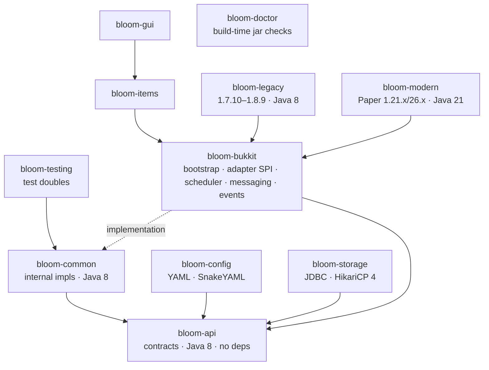

# Bloom Architecture

> Status legend used throughout Bloom docs: **Implemented** (code + tests exist), **Partial**, **Planned** (no code yet).
> The live status of every item is tracked in [`docs/plans/PROGRESS.md`](../plans/PROGRESS.md).

## 1. Goals in one paragraph

Bloom lets one plugin codebase target two very different Minecraft generations — legacy Bukkit/Spigot
(1.7.10–1.8.9, Java 8) and modern Paper (1.21.x and 26.x, Java 21+) — through a stable API, while keeping
every version difference behind an explicit adapter boundary. It is embedded (shaded + relocated) into each plugin.

## 2. Module map



Arrows point at dependencies. There are no cycles. `bloom-common` is always an `implementation` dependency, so
plugin code cannot compile against Bloom internals.

| Module | Bytecode | Compiles against | Purpose |
|---|---|---|---|
| `bloom-api` | Java 8 | JDK only | Stable contracts: platform model, capabilities, services, scheduler, text, utilities |
| `bloom-common` | Java 8 | `bloom-api` | Internal implementations: service registry, tracking scheduler, text conversion |
| `bloom-config` | Java 8 | SnakeYAML 2.7 | YAML configuration, validation, migrations, object mapping |
| `bloom-storage` | Java 8 | HikariCP 4.0.3 API | Async JDBC (SQLite, MySQL, MariaDB), transactions, migrations |
| `bloom-testing` | Java 8 | `bloom-common` | Test doubles for plugin unit tests (manual scheduler) |
| `bloom-bukkit` | Java 8 | spigot-api 1.8.8 | `Bloom` entry point, platform detection, adapter SPI + loader, scheduler, messenger, events |
| `bloom-items` | Java 8 | spigot-api 1.8.8 | Item builder, cross-version materials, custom item identity, serialization |
| `bloom-gui` | Java 8 | spigot-api 1.8.8 | Inventory menus, pagination, confirmation dialogs, layouts |
| `bloom-legacy` | Java 8 | spigot-api 1.8.8 | Adapter for 1.7.10–1.8.9 (reflection for NMS-only features) |
| `bloom-modern` | Java 21 | paper-api 1.21.11 (+ verified vs 1.21.1 and 26.3) | Adapter for Paper: Adventure, MiniMessage, PDC |
| `bloom-doctor` | Java 8 | ASM | CLI that validates built plugin jars |

Repository layout: `website/` (docs site, Cloudflare Workers static assets), `docs/` (plans, architecture,
guides), `scripts/` (real-server test harness), `.claude/skills/bloom/` (AI skill), `bloom-examples/`.

## 3. Why shared Bukkit code compiles against 1.8.8

`bloom-bukkit`, `bloom-items` and `bloom-gui` are compiled once, as Java 8 bytecode, against the oldest Bukkit
API Bloom can legally obtain (spigot-api 1.8.8). Any Bukkit member they reference must exist with the **same
binary shape** on every supported server. Known hazards, all verified against the real API jars:

| Hazard | Versions | Rule |
|---|---|---|
| `Bukkit.getOnlinePlayers()` returns `Player[]` on 1.7.10, `Collection` on 1.8+ | 1.7.10 | Never call directly; use the adapter |
| `InventoryView` is an abstract class ≤1.20, an interface in 1.21+ (`IncompatibleClassChangeError`) | 1.21+ | Never invoke methods on `InventoryView` in shared code |
| `ItemMeta.spigot()` removed on modern Paper | 1.21+ | Unbreakable handled by adapters |
| `ItemFlag` absent on 1.7.10 | 1.7.10 | Shared code uses Bloom's own `ItemFlagKey`; adapters map by name |
| Material constants renamed in 1.13 (`WOOL:14` → `RED_WOOL`) | all | Resolve materials by name through the adapter + mapping table |
| Inventory titles limited to 32 chars | ≤1.8 | Adapter truncates with a warning |

`bloom-doctor`'s linkage check (Planned) will enforce these rules automatically by resolving every Bukkit
reference in compiled classes against each target API jar.

## 4. Startup sequence

```
Bloom.enable(plugin)                                  (bloom-bukkit, main thread)
 ├─ PlatformDetector: Server name/version strings + class probes → PlatformInfo
 ├─ SupportPolicy.evaluate(...) → LEGACY | MODERN | unsupported (BloomStartupException with a fix-it message)
 ├─ AdapterLoader: derive class name from Bloom's *runtime* package (relocation-safe),
 │    Class.forName only for the selected family → missing adapter → clear "add bloom-modern" error
 ├─ adapter.enable(context) → adapter probes optional features → Capabilities
 ├─ core services: TrackingScheduler(BukkitSchedulerBackend), Messenger, Events
 └─ startup banner: version, platform, adapter, capabilities
```

Because the modern adapter is Java 21 bytecode, it must never be loaded on a Java 8 server. Bloom never
references adapter classes symbolically; the selected class is loaded by name only after the policy accepted the
platform. Unselected adapters are never touched.

## 5. Lifecycle and ownership

- One `Bloom` instance per plugin (embedded mode). `Bloom.enable` → `RUNNING`; `bloom.shutdown()` in
  `onDisable` → `STOPPED`. Shutdown order: feature services (menus close open inventories) → event
  subscriptions → scheduler tasks → adapter.
- Every resource Bloom creates (task, subscription, service, database pool) is registered with the instance and
  closed at shutdown. Failures while closing are logged, never thrown.
- Bloom does **not** auto-shutdown on `PluginDisableEvent`: Bukkit fires that event *before* `onDisable`, which
  would break plugins that save data in `onDisable`.

## 6. Threading model

- Game state (players, worlds, inventories) is touched only on the main thread. Bloom APIs that require it call
  `scheduler.ensurePrimaryThread(...)` and fail fast with a message explaining how to switch threads.
- `bloom-storage` executes JDBC work on its own bounded pool and returns `CompletableFuture`s; completions are
  moved back with `scheduler().mainThreadExecutor()`.
- GUI navigation triggered inside click handlers is deferred to the next tick (opening inventories during
  `InventoryClickEvent` is unsafe on Bukkit).
- Folia is detected and rejected (its regionised scheduler needs a dedicated adapter — Planned).

## 7. Text pipeline

Messages are written in `TextFormat.LEGACY` (`&` codes) or `TextFormat.MINIMESSAGE`. `TextTemplates` substitutes
`{placeholders}` with per-format escaping (untrusted values cannot inject formatting). Then:

- modern adapter: real MiniMessage / Adventure legacy serializer → `Component`
- legacy adapter: `MiniMessageLite` subset converter → `§` string (hex downsampled to nearest legacy colour)

## 8. Item identity strategy

Custom items are identified by a namespaced key/value stored in the item's persistent data, never by display
name:

- modern: `PersistentDataContainer` with `NamespacedKey(plugin, key)`
- legacy: a `BloomData` NBT compound written through version-specific reflection on `CraftItemStack`
  (probed at startup; capability `ITEM_NBT_TAGS`).

Data written on one family is not readable on the other (different storage formats); servers do not move between
families, so this is documented rather than bridged.

## 9. Distribution

Embedded mode (supported first): plugins shade Bloom modules and **must relocate**
`io.github.crownalonedev.bloom` (and SnakeYAML/HikariCP when used). Bloom warns at startup if it detects it was
loaded from another plugin's class loader (unrelocated duplicate). Standalone runtime plugin mode is Planned and
will not be marked production-ready until its lifecycle and version negotiation are implemented and tested.
